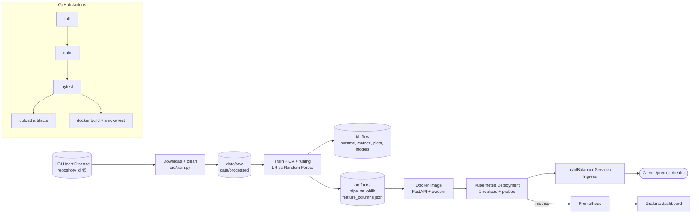

# Report and video guide

The final report (about 10 pages, .docx or .pdf) and the video must be your own work. This guide gives the structure, the architecture diagram, and a recording plan. Write the explanations in your own words: the assignment warns that near-identical reports are flagged.

## Report outline (about 10 pages)

1. **Title page**: course, assignment, name, ID, repository link https://github.com/2025ae05519/mlops_assignment_01.
2. **Introduction** (½ page): problem statement, dataset (UCI Heart Disease, id 45, 303 rows, 13 features), binary target (0 vs 1–4).
3. **Setup and installation** (½ page): summarise `docs/RUNBOOK.md` steps 1–6.
4. **Data cleaning and EDA** (1½ pages): missing values (`ca`, `thal`), target mapping, imputation inside the pipeline (median for numeric, most frequent for categorical). Insert the class balance, histogram and correlation plots and say what you observed.
5. **Feature engineering and modelling** (1½ pages): one-hot encoding of the nominal features (`cp`, `restecg`, `slope`, `thal`), scaling for Logistic Regression only, Random Forest grid search, stratified 5-fold CV. Include the CV and test tables from `artifacts/cross_validation_results.csv` and `artifacts/test_evaluation_results.csv`. Explain the selection rule: the model is chosen on CV ROC-AUC (LR 0.907 vs tuned RF 0.902), not on the held-out test score, to avoid test-set leakage. Mention that RF had higher test accuracy and F1 (LR had the higher test ROC-AUC) and why you still kept the rule.
6. **Experiment tracking** (1 page): MLflow setup (SQLite backend), what is logged per run, and screenshots 04–06.
7. **Packaging and reproducibility** (½ page): joblib pipeline with preprocessing, `feature_columns.json` contract, pinned `requirements.txt`, fixed random seed.
8. **API and containerisation** (1 page): `/health` (503 when the model is missing), `/predict` (prediction + confidence), `/metrics`; Dockerfile with HEALTHCHECK; screenshots 08–10.
9. **CI/CD** (1 page): the two jobs, artifacts, failure behaviour; screenshots 17–19.
10. **Deployment** (1 page): Kubernetes Deployment (2 replicas, probes, resources) and LoadBalancer Service, optional Ingress; screenshots 11–13; access instructions.
11. **Monitoring and logging** (½ page): request logs, Prometheus metrics, Grafana dashboard; screenshots 14–16.
12. **Architecture diagram** (½ page): see below.
13. **Conclusion and future work** (½ page): e.g. model registry, data drift checks, pushing the image to a registry, cloud deployment.

## Architecture diagram

Render this Mermaid diagram (paste into https://mermaid.live and export a PNG), or redraw it in draw.io in your own style.

## Video recording plan (about 5–8 minutes)

Use OBS, Loom or your OS screen recorder, and narrate what you are doing.

1. Repository tour: folders, README, runbook (30 s).
2. Notebook EDA plots (45 s).
3. `python -m src.train` output, then the MLflow UI with both runs and plots (1 min).
4. `pytest -v` passing (20 s).
5. GitHub Actions: a green run, both jobs, the uploaded artifact (45 s).
6. `docker build` and `docker run`, then the smoke test (45 s).
7. `kubectl apply`, `kubectl get pods,svc`, a prediction through the LoadBalancer (1 min).
8. `docker compose up`, generate traffic, Prometheus query and the Grafana dashboard (1 min).
9. Wrap-up (20 s).

Upload it to YouTube (unlisted) or Google Drive (anyone with the link) and put the link in the README and the report.

## Final submission checklist

- [ ] All screenshots in `screenshots/` and committed
- [ ] Report saved as `report/MLOps_Assignment_01_Report.pdf` (or .docx) and committed
- [ ] Video link added to the README "Submission links" section
- [ ] Latest GitHub Actions run on `main` is green
